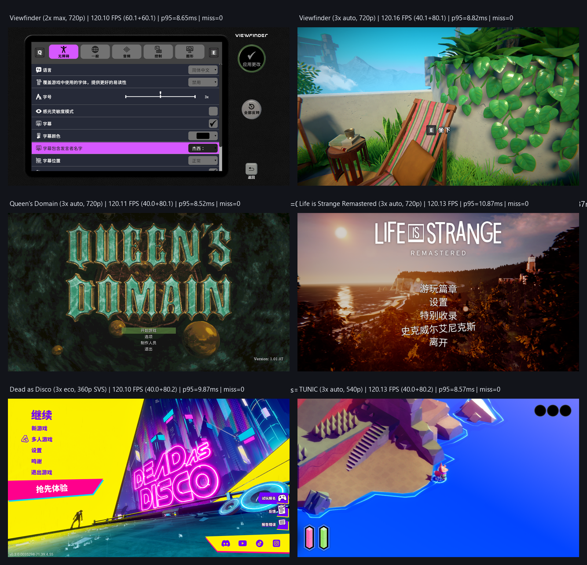
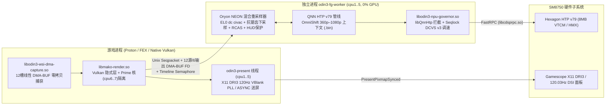

# Odin3-FG-NPU

面向 **AYN Odin 3**（高通骁龙 8 至尊版 `SM8750`：Hexagon HTP v79 NPU + Oryon 八核 CPU + Adreno 830 GPU，运行 ArmadaOS / Gamescope）的本地 **Hexagon NPU 分档混合补帧**与 **NPU 动态功耗调速**双 Decky 插件及运行时。

本项目通过 Vulkan 隐式层拦截游戏交换链，经由零拷贝 `DMA-BUF` 与独立推理进程 `odin3-fg-worker` 协同，在高通 Hexagon HTP v79 NPU 与 Oryon Phoenix-M 能效核（ARM64 NEON）上完成帧间插值，并通过 X11 DRI3 硬件 VBlank 相位锁定直出上屏，使补帧子进程的 **Adreno GPU 渲染负载保持 `0.00%`**，不抢占游戏的 GPU 着色器与显存带宽。

---

## 一、实机帧率表现与客观局限说明

### 1. 锁定 120 Hz 实机吞吐表现

在 Odin 3 实机 120 Hz 面板（校准 `120.03 Hz`）下，已对多款 2D/3D 游戏（*Return of the Obra Dinn*、*The Witness*、*The Talos Principle*、*Scarlet Hollow*、*Viewfinder*、*Queen's Domain*、*Life is Strange Remastered*、*Dead as Disco*、*TUNIC*）完成实测验证：

- **2× 补帧（源帧上限 60 FPS → 120 Hz 输出）**：稳定输出 **`60 原生帧 + 60 生成帧 = 120 FPS`**（1:1 严格交替，漏补 `0`，重复帧 `0`）。
- **3× 补帧（源帧上限 40 FPS → 120 Hz 输出）**：稳定输出 **`40 原生帧 + 80 生成帧 = 120 FPS`**（1:2 严格交替，漏补 `0`，重复帧 `0`）。
- **不限源帧率（高原生帧场景）**：自动采用紧凑低开销推理与等距异步送屏，在避免拖慢原生帧率的前提下插入生成帧。



详细实机测试记录见 [`docs/benchmarks/`](docs/benchmarks/)。

### 2. 当前画质与体感局限（重要说明）

尽管帧数吞吐、原生帧保留率与功耗控制达到了设计指标，**当前版本的实际画面观感与镜头旋转流畅度仍存在明显不足**：

1. **无引擎运动矢量与深度输入（纯盲插帧）**：作为外部 Vulkan 层通用插件，系统无法获取游戏内部的逐像素 Motion Vector、深度缓冲或摄像机矩阵，只能仅凭相邻两帧 `RGB` 图像推断运动。在**快速旋转 3D 镜头、大位移视差、复杂遮挡/反遮挡边缘**场景下，容易出现重影、几何边缘撕裂、果冻感或体感流畅度下降。
2. **移动端 NPU 容量与定点量化限制**：为保证模型完全驻留 `SM8750` Hexagon HTP 的 8 MB VTCM 并在 `6–15 ms` 内完成推理，自研 **OmniShift** 网络采用纯卷积轻量结构与 `W8A8`（8-bit 权重 + 8-bit 激活）定点量化，对大跨度非刚性运动与复杂纹理的表达能力有限。
3. **中低功耗档位混合超分闪烁**：在 `Eco (360p)`、`Saver (540p)`、`Balanced/Auto (720p)` 等档位下，生成帧以较低内部分辨率在 NPU 上推理后再经 CPU NEON 上采样与 `3×3` RCAS 锐化送屏；与 `1080p` 原生帧高频交替时，精细纹理处会出现奇偶帧清晰度差异带来的闪烁感。
4. **动态半透明 UI 伪影**：静态 HUD 通过相邻帧差分掩码在全分辨率下保护，但随背景剧烈变化的半透明 UI、滚动文字或细密网格仍可能产生局部伪影。

本仓库完整公开当前插件、Vulkan 层、HTP/NEON 混合工作进程以及 PyTorch 训练与 QNN HTP 离线编译代码，供查阅、复现或继续改进。

---

## 二、使用说明

### 1. 环境与前置要求

- **设备与系统**：AYN Odin 3（`SM8750` / `aarch64`），运行 ArmadaOS（Steam 游戏模式 + Gamescope + Decky Loader）。
- **高通 QAIRT 运行时库（需自行准备）**：
  本仓库及 GitHub Release **不包含任何高通专有闭源 SDK 库文件**。运行前请从 Qualcomm AI Engine Direct (QAIRT / QNN SDK，需支持 Hexagon HTP `v79`) 提取以下运行库并放置到 `~/.local/share/odin3-fg/qairt/`（也可从设备系统已有的高通 QNN 运行目录复制）：

  ```text
  ~/.local/share/odin3-fg/qairt/
  ├── lib/
  │   ├── libQnnHtp.so
  │   ├── libQnnSystem.so
  │   ├── libQnnHtpV79Stub.so
  │   └── libQnnHtpPrepare.so   # 可选
  └── hexagon/
      └── libQnnHtpV79Skel.so
  ```

### 2. 安装步骤

从本仓库 [Releases](https://github.com/54pkp/Odin3-FG-NPU/releases) 下载以下四个文件并传入掌机（例如放在 `/tmp/`）：

- `odin3-fg-runtime.tar`（开源 Vulkan 层 + `odin3-fg-worker` + FastRPC 运行包）
- `omnishift-sm8750-models.tar.gz`（自训练 5 分辨率 `360p–1080p` OmniShift HTP v79 模型包）
- `odin3-fg-npu-decky.zip`（补帧控制 Decky 插件）
- `odin3-npu-power-decky.zip`（NPU 功耗/性能调速 Decky 插件）

在 Odin 3 终端（SSH 或桌面终端，默认用户 `armada`）依次执行：

```bash
# 1. 创建数据目录并解压 5 档位 HTP 模型包
mkdir -p ~/.local/share/odin3-fg/models
tar -xzf /tmp/omnishift-sm8750-models.tar.gz -C ~/.local/share/odin3-fg/models

# 2. 部署版本化运行时管理器并激活运行包
cp runtime/install_runtime.py ~/.local/share/odin3-fg/install_runtime.py
RT_SHA=$(sha256sum /tmp/odin3-fg-runtime.tar | awk '{print $1}')
python3 -I ~/.local/share/odin3-fg/install_runtime.py stage /tmp/odin3-fg-runtime.tar --sha256 "$RT_SHA"
python3 -I ~/.local/share/odin3-fg/install_runtime.py activate "$RT_SHA" -- \
    /usr/bin/test -x ~/.local/share/odin3-fg/versions/"$RT_SHA"/odin3-fg-worker

# 3. 安装两个 Decky 插件并重启 Decky 服务
sudo unzip -oq /tmp/odin3-fg-npu-decky.zip -d ~/homebrew/plugins/
sudo unzip -oq /tmp/odin3-npu-power-decky.zip -d ~/homebrew/plugins/
sudo chown -R "$USER:$USER" ~/homebrew/plugins/odin3-fg-npu
sudo chown -R root:root ~/homebrew/plugins/odin3-npu-power
sudo chmod 0755 ~/homebrew/plugins/odin3-fg-npu/py_modules/odin3_fg_launch.py \
                ~/homebrew/plugins/odin3-npu-power/assets/libodin3-npu-governor.so
sudo systemctl restart plugin_loader.service
```

> 也可以直接在 Steam 游戏模式的 **Decky 设置 → 开发者 → 从 ZIP 文件安装插件** 中分别选择 `odin3-fg-npu-decky.zip` 与 `odin3-npu-power-decky.zip` 安装。

### 3. 游戏内开启与档位调节

1. **先启动一次目标游戏或停留在目标游戏详情页**，按下掌机快捷菜单键打开 Decky 插件栏，进入 **`Odin3 FG NPU`**：
   - **补帧倍率**：
     - `关闭（原生直通）`：自动移除补帧启动项，游戏完全按原设置运行。
     - `2× 分档混合补帧`：适合原生能稳定达到 `60 FPS` 的游戏，补帧至 `120 FPS`。
     - `3× 分档混合补帧`：适合原生能稳定达到 `40 FPS` 的游戏，补帧至 `120 FPS`。
   - **源帧率上限**：
     - 希望锁定 `120 Hz` 等距平滑送屏并启用高内部分辨率模型时，建议在 `2×` 下选 **`60`**、在 `3×` 下选 **`40`**。
     - 若选择 **`不限（原生无损）`**，高帧率游戏不强制锁帧，自动使用超低延迟 `360p` 紧凑档辅助插帧。
   - **目标屏幕刷新率**：默认 `120 Hz`（启动游戏时自动同步 Gamescope 刷新率并在退出游戏后还原）。
   - 修改补帧开关或源帧上限后**需重启当前游戏生效**（插件会自动在 Steam 启动项中写入或移除 `~/.local/share/odin3-fg/bin/odin3-fg-launch %command%`）。
   - 游戏内请**关闭 HDR** 以及游戏自带的其他帧生成功能。

2. 打开 **`Odin3 NPU 性能调节`（`Odin3 NPU Power`）** 选择 NPU 功耗与画质档位（**对正在运行的游戏即时热生效，无需重启游戏**）：

| NPU 档位 | HTP 核心电压角上限 | 总线电压角上限 | 锁定 120 Hz 下匹配的内部推理分辨率（1080p 交换链） | 适用场景 |
| :--- | :--- | :--- | :--- | :--- |
| **`Eco`（省电静音档）** | `SVS / SVS+` | `SVS` | `640×360`（`360p` 混合超分） | 最低整机功耗与发热，适合续航优先 |
| **`Saver`（能效优先档）** | `NOM+` | `NOM` | `960×540`（`540p` 混合超分） | 明显降低 NPU 与 LPDDR5X 带宽功耗 |
| **`Balanced`（均衡甜点档）** | `TURBO` | `NOM+` | `1280×720`（`720p` 混合超分） | 兼顾清晰度、延迟与发热 |
| **`Auto`（智能动态档，推荐）** | 动态 `NOM ~ MAX` | 动态 `SVS+ ~ TURBO+` | `1280×720`（`720p` 混合超分） | 按实时推理占空比自动升降压并保留帧间深度休眠 |
| **`High`（高性能档）** | `MAX`（帧间休眠） | `NOM+` | `1600×900`（`900p` 混合超分） | 高清晰度推理且允许帧间关断 HMX |
| **`Max`（满血极限档）** | `MAX` | `NOM+` | `1600×900`（`900p` 混合超分） | 最高 NPU 算力档位（若交换链本身为 `720p/900p` 则直接原生零缩放推理） |
| **`Passthrough`（原厂不干预）** | 客户端默认投票 | 客户端默认投票 | 最高可用档位 | 旁路电压调节器 |

### 4. 版本回滚与卸载

```bash
# 回滚到上一个激活的运行时版本
python3 -I ~/.local/share/odin3-fg/install_runtime.py rollback

# 查看当前激活版本状态
python3 -I ~/.local/share/odin3-fg/install_runtime.py status
```

如需彻底卸载：
1. 在 `Odin3 FG NPU` 中将开启过补帧的游戏切回 `关闭（原生直通）`（或删除启动项中的 `~/.local/share/odin3-fg/bin/odin3-fg-launch`；即便保留该启动项，在运行时目录删除后它也会自动无损透传原游戏命令）。
2. 还原 QAIRT 原始库并清理插件与数据目录：
   ```bash
   if [[ -f ~/.local/share/odin3-fg/qairt/lib/libQnnHtp.real.so ]]; then
       mv -f ~/.local/share/odin3-fg/qairt/lib/libQnnHtp.real.so ~/.local/share/odin3-fg/qairt/lib/libQnnHtp.so
   fi
   sudo rm -f /etc/systemd/system/vela-npu.service.d/60-odin3-npu-governor.conf \
              /etc/tmpfiles.d/odin3-npu-governor.conf \
              /etc/tmpfiles.d/odin3-fg-panel-120hz.conf
   sudo systemctl daemon-reload
   sudo rm -rf ~/homebrew/plugins/odin3-fg-npu ~/homebrew/plugins/odin3-npu-power /var/lib/odin3-npu-governor /run/odin3-npu-governor
   rm -rf ~/.local/share/odin3-fg ~/.config/odin3-fg ~/.cache/odin3-fg \
          ~/.config/odin3-npu-governor ~/.cache/odin3-npu-governor \
          ~/.local/share/vulkan/implicit_layer.d/VkLayer_MAKO_render.json
   sudo systemctl restart plugin_loader.service
   ```

---

## 三、上游技术与开源致谢

当前补帧插件与工具链实际基于以下上游项目与平台技术构建（详见 [`sources.json`](sources.json) 与 [`licenses/`](licenses/)）：

1. **[MAKO](https://github.com/eugeniosegala/MAKO)**（`GPL-3.0-or-later`，源自 **[lsfg-vk](https://github.com/PancakeTAS/lsfg-vk)**）：
   提供 Vulkan 隐式层骨架（`VK_LAYER_MAKO_render` / `libmako-render.so`）、交换链生命周期管理以及渲染层与外部帧生成进程之间的 Unix `SOCK_SEQPACKET` + Vulkan Timeline Semaphore 通信框架。本项目在此基础上实现了零拷贝 WSI `DMA-BUF` 捕获、X11 DRI3 硬件 VBlank 相位锁定送屏、多 `VkInstance`/`VkDevice` 并发分发表保护以及 Hexagon HTP 共享缓冲调度协议。
2. **[Qualcomm FastRPC](https://github.com/qualcomm/fastrpc)**（`BSD-3-Clause`）与 **Qualcomm QAIRT / QNN HTP SDK**：
   使用开源 `cdsprpcd` 与 `libcdsprpc.so` 建立 Linux 用户态与 `SM8750` Hexagon cDSP 的 FastRPC 会话及零拷贝 `DMA-BUF` 内存注册，通过 QNN HTP `v79` 接口加载执行离线编译的上下文二进制图（`.bin`），并通过 `QnnHtpPerfInfrastructure`（`DCVS_V3`）控制核心/总线电压角、RPC 唤醒延迟与 HMX 断电超时。
3. **[Decky Loader](https://github.com/SteamDeckHomebrew/decky-loader)**（`BSD-3-Clause`）：
   提供 Steam 游戏模式快捷菜单插件框架；Steam `localconfig.vdf` 启动项无损同步逻辑参考了社区 `decky-lsfg-vk` 的设计思路。
4. **Gamescope / Mesa Turnip Vulkan WSI / X11 DRI3 & Present 扩展**：
   利用 Mesa X11 WSI 在交换链创建时的 DRI3 `DMA-BUF` 导出接口与 Gamescope `:0` 的 `PresentPixmapSynced` 显式同步原语，直接将原生帧与生成帧按硬件 VBlank 节拍交替送显。
5. **[Khronos Vulkan-Headers](https://github.com/KhronosGroup/Vulkan-Headers)**（`Apache-2.0`）与 **[LibYAML](https://github.com/yaml/libyaml)**（`MIT`）：
   分别用于 Vulkan 层交叉编译与 FastRPC 库构建。
6. **PyTorch & ONNX**：
   用于自研纯卷积插帧网络 **OmniShift** 的训练、W8A8 量化感知微调（QAT）及静态 NHWC 计算图导出。

---

## 四、技术说明（系统架构详解）



### 1. 零拷贝 WSI `DMA-BUF` 捕获桥（`engine/wsi-dma-capture/`）

传统 Vulkan 补帧层需要每帧在游戏图形队列上额外执行一次全屏 `vkCmdCopyImage` 将交换链图像复制到外部共享内存，在 `1080p` 高帧率下会引入显著的 GPU 带宽开销与队列同步气泡。

本项目的 `libodin3-wsi-dma-capture.so` 在游戏创建交换链的瞬态窗口内拦截 `xcb_dri3_get_supported_modifiers_reply` 与 `xcb_dri3_pixmap_from_buffers_checked`，优先协商线性 `DRM_FORMAT_MOD_LINEAR` 修饰符并直接复制出 12 个底层交换链图像的 `DMA-BUF` 文件描述符。游戏渲染完成后仅通过零命令缓冲的空队列提交中继 `VkTimelineSemaphore`，即可将同一块物理内存同时用于：
- X11 DRI3 原生帧零拷贝直接送屏；
- `odin3-fg-worker` 直接读取并生成中间帧。

对于不支持线性修饰符直通的交换链，渲染层自动回退到预录制并按槽位缓存的 `VK_PIPELINE_STAGE_TRANSFER_BIT` 异步传输池，不在图形管线顶部插入全管线阻塞屏障。

### 2. X11 DRI3 硬件 VBlank 相位锁定（PLL）送屏调度（`engine/mako-render/`）

`independent_real_present.cpp` 与 `direct_x11_present.hpp` 在独立线程 `odin3-present` 中绕过游戏的 `vkQueuePresentKHR` 阻塞路径，直接通过 XCB `PresentPixmapSynced` 向 Gamescope 提交 12 个原生帧槽位与 6 个生成帧槽位：

- **锁定 120 Hz VBlank PLL 模式**：利用 DRI3 `PresentCompleteNotify` 返回的硬件翻页微秒时间戳（`ust`）与计数器（`msc`）建立锁相环，在每个 `8.33 ms` VBlank 周期的 **22% 相位点**精确锚定节拍，严格按 `G -> O`（`2×`）或 `G1 -> G2 -> O`（`3×`）顺序锁定目标 `target_msc` 提交。
- **`3×` 动态单/双相位自适应**：在 `3×` 模式下，同一个 HTP 上下文同时挂载双相位解码图（`phase13.bin` + `phase23.bin`）与中点解码图（`phase12.bin`）。当锁定 40 FPS 源帧时运行完整双相位（`1:2` 输出 120 FPS）；当不锁帧且源帧率高于 ~55 FPS 时自动切为单相位中点插帧，避免双相位超时丢帧。
- **不锁帧等距 `ASYNC` 模式**：当用户未限制源帧率且原生帧率已超过面板半帧率时，自动启用 `XCB_PRESENT_OPTION_ASYNC` 等距无回压送屏，防止垂直同步队列反压降低游戏原生帧率。
- **面板刷新率热校准**：Odin 3 出厂 DSI `frame_len_120=76` 实际刷新率约为 `118.96 Hz`，会导致 60/40 FPS 锁帧产生周期性拍频微卡顿；`Odin3 FG NPU` 后端自动将其校准至 `56`（实测 `120.02–120.14 Hz`）。

### 3. OmniShift 纯卷积多尺度光流插帧网络（`training/omnishift_vfi.py`）

针对 `SM8750` Hexagon HTP v79 硬件特性专门设计并从头训练的端到端纯卷积插帧模型（零自定义 HVX/DSP 算子、零 `GridSample` 回退）：

- **HTP 64 通道张量块对齐与全 VTCM 驻留**：内部特征通道严格对齐 64 的整数倍（`48/64/96/192/384`），中间激活全部驻留在 8 MB 片上 VTCM 内，避免频繁读写 LPDDR5X。
- **零偏置对称 `[0, 1]` `YBGR24` 编解码器**：通过 `4×4` Space-to-Depth 将输入拆解为 16 通道 `1×1` 全分辨率亮度 `Y_p` 与 8 通道 `2×4` 半块平均 `B_h, G_h, R_h, Y_h`，解码端按无偏置恒等式 `C_p = C_h + Y_p - Y_h` 重构。纯黑 `[0,0,0]` 输入全通道精确为零；单色/1-bit 点阵画面（`B == G == R`）在位移后四组半块色度权重逐位一致，严格保持零色差。
- **精确互补合一分区权重（`w0 = 1 - sum(wnz)`）与无彩线边界复制**：在粗粒度三元位移层（`ExactComplementTernaryCoarse24`）与细粒度 8 抽头 `[-4, +4] px` 帐篷核层（`ExactComplementTent8Tap4px24`）中，静止权重 `w0` 直接由量化后的非零位移权重 `wnz` 互补求得，保证任意光流边界处权重之和恒等于 `255/255 = 1.0`，消除纯白 `[255,255,255]` 量化崩裂；全部空间卷积采用显式边缘复制填充（`replicate_pad_2d`），彻底消除屏幕底边彩色溢出线。
- **多图拆分架构**：每个分辨率档位包含 5 个离线编译上下文：
  - `vfi-joined.bin`：原生分辨率 `2×`（`t=0.5`）单次融合推理图；
  - `vfi-motion3x.bin`：双帧共享对称光流与遮挡潜变量编码器（每对源帧仅运行 1 次）；
  - `phase12.bin` / `phase13.bin` / `phase23.bin`：分别对应 `t=1/2`、`t=1/3`、`t=2/3` 的轻量相位合成解码器。

### 4. Oryon 大小核隔离与 ARM64 NEON 混合重采样引擎（`worker/odin3_tier_engine.hpp`）

`SM8750` 拥有 6 颗 `3.53 GHz` Phoenix-M 核心（`cpu0..5`）与 2 颗 `4.09 GHz` Phoenix-L 超大核（`cpu6..7`）：

- **双簇严格隔离**：渲染层后台监控游戏线程 CPU 时间片，自动将最重的 1–2 个游戏主渲染线程固定至 `cpu6..7` 超大核；同时将 `odin3-present` 与 `odin3-fg-worker`（含 NEON 线程池）限制在 `cpu1..5`（避开承载系统中断的 `cpu0`），确保补帧计算零抢占游戏超大核。
- **用户态 EL0 `dc civac` 按行缓存维护**：直接对 `mmap` 的系统 `DMA-BUF` 虚拟地址按实际采样行执行 ARM64 `dc civac` 指令，无需陷入内核执行整帧 `DMA_BUF_IOCTL_SYNC` 等待显卡 `dma_resv` 栅栏。
- **NEON 抗锯齿下采样 + 无振铃 RCAS + 静态 HUD 无损融合**：
  - 下采样支持 `2×2` Box（`1080p→540p`）、带非临时流式写指令 `stnp` 的精确 `3:2` 盒式滤波（`1080p→720p`）与 `3×3` Tent 抗锯齿核（`1080p→360p`），抑制旋转镜头下的高频摩尔纹混叠；
  - 上采样在单遍扫描内融合双线性插值、自适应无振铃 `3×3` RCAS 局部对比度锐化（按功耗档位调节锐化上限并抑制方向性块振铃）以及全分辨率静态 HUD / 单色保护（检测 `|A - B|` 静止像素直接取全清原生像素）；
  - 在 `3×` 混合超分模式下，子线程异步执行 `P().render(1)`（第 2 相位 NPU 推理）与主线程 `upsampleOutput(0)`（第 1 相位 NEON 上采样）完全并行重叠。

### 5. `libQnnHtp.so` 拦截调速器与温控保护（`npu-governor/npu_governor_shim.cpp`）

由于 `SM8750` NPU 在 Linux 内核下不暴露通用 `devfreq` 调频节点，所有频率、电压角与休眠均由用户态通过 QNN `DCVS_V3` 投票决定：

- `libodin3-npu-governor.so` 以同名 `libQnnHtp.so` 形式前置加载，包装 `QnnInterface_getProviders`、`deviceGetInfrastructure` 与 `graphExecute`；
- 强制下发 `RPC_POLLING_TIME = 0`，禁止高通宿主库在 ARM CPU 上忙轮询等待 DSP 完成，使 CPU 在推理期间进入 `WFI` 休眠；
- 每次推理前以无锁原子指令轮询 `/run/odin3-npu-governor/config.bin` 的 128 字节 Seqlock 配置块，实现零重启热切换电压角，并向 `/run/odin3-npu-governor/telemetry/` 输出实时推理帧率、单次耗时、占空比与电压档位遥测；
- `odin3-fg-worker` 同步监测 `nsphmx` 热区温度，在超过 `85°C / 88°C / 90.5°C` 时自动限制最高内部分辨率档位，防止长时间满载过热降频。

---

## 五、仓库目录结构与源码构建

```text
Odin3-FG-NPU/
├── engine/                 # Vulkan 隐式层 (libmako-render.so) 与零拷贝 WSI 捕获库 (libodin3-wsi-dma-capture.so)
│   ├── mako-common/        # Vulkan 封装、配置与 htp_deadline 运行参数
│   ├── mako-backend/       # 独立 worker 进程管理与共享 DMA-BUF 调度协议
│   ├── mako-render/        # 交换链钩子、X11 DRI3 VBlank PLL 送屏器与 Oryon 线程编排
│   └── wsi-dma-capture/    # xcb-dri3 线性修饰符协商与 DMA-BUF 导出拦截层
├── worker/                 # 独立进程补帧引擎 (odin3-fg-worker)：QNN HTP v79 管线 + Oryon NEON 混合重采样器
├── npu-governor/           # libQnnHtp.so 动态电压/休眠拦截层 (libodin3-npu-governor.so)
├── runtime/                # 版本化运行时安装器 (install_runtime.py)、启动包装器 (odin3-fg.sh) 与配置管理
├── decky-fg/               # Decky 插件：Odin3 FG NPU（游戏级补帧配置与面板校准）
├── decky-npu-power/        # Decky 插件：Odin3 NPU Power（实时 NPU 档位调节与功耗/温度遥测）
├── training/               # OmniShift PyTorch 网络定义、FP32+W8A8 QAT 训练脚本与 QNN HTP v79 5尺度编译脚本
├── scripts/                # 一键交叉编译打包脚本 (build_all.py) 与验收校验脚本 (check_acceptance.py)
├── docs/                   # 实机测试对比图与基准测试 JSON 记录
├── licenses/               # 上游开源组件许可证文本 (MAKO / FastRPC / LibYAML)
└── sources.json            # 实际使用的上游开源仓库与锁定提交哈希
```

### 1. 交叉编译运行时与 Decky 插件

构建依赖：
- Python `>= 3.11`
- [Zig](https://ziglang.org/) `>= 0.14`（提供 `aarch64-linux-gnu` C/C++ 交叉编译器）
- Node.js `>= 18`（用于构建两个 Decky 插件的 TypeScript/React 前端）
- Khronos `Vulkan-Headers`、`aarch64` Linux/X11/XCB/DRM 系统头文件及 `libvulkan.so.1` 链接桩
- Qualcomm QAIRT SDK 的 `include/QNN` 头文件目录
- 开源编译好的 `aarch64` `qualcomm/fastrpc` 二进制（`cdsprpcd`、`libcdsprpc.so`、`libcdsp_default_listener.so.1`）

设置路径环境变量后一键构建全部产物（输出至 `dist-release/`）：

```bash
export ODIN3_ZIG=/path/to/zig
export ODIN3_VULKAN_INCLUDE=/path/to/Vulkan-Headers/include
export ODIN3_LINUX_SYSROOT=/path/to/aarch64-sysroot/usr/include
export ODIN3_QAIRT_INCLUDE=/path/to/qairt/include/QNN
export ODIN3_VULKAN_STUB_SO=/path/to/aarch64-sysroot/usr/lib/libvulkan.so.1
export ODIN3_FASTRPC_DIR=/path/to/fastrpc-aarch64

python scripts/build_all.py --models-dir /path/to/omnishift-sm8750
```

### 2. 训练 OmniShift 模型并编译 SM8750 HTP 二进制

```bash
# 1. 训练 FP32 + Stage-2 W8A8 QAT 模型（传入 [N, 3, H, W, 3] uint8 BGR 三元组 .npy 数据集）
python training/train_omnishift.py \
    --data-npy /path/to/triplets.npy \
    --out-dir runs/omnishift_sm8750 \
    --steps 20000 --qat-start 15000

# 2. 导出 5 尺度 (360p/540p/720p/900p/1080p) ONNX 图并调用 QAIRT 编译为 HTP v79 上下文 (.bin)
python training/export_and_compile_htp.py \
    --ckpt runs/omnishift_sm8750/omnishift_vfi_sm8750.pt \
    --qairt-sdk /path/to/qairt/2.x \
    --out-dir models/omnishift-sm8750
```

---

## 六、许可证

本仓库源码基于 **[GNU General Public License v3.0 or later (`GPL-3.0-or-later`)](LICENSE)** 发布。第三方开源组件的原始许可证见 [`licenses/`](licenses/) 目录。Qualcomm QAIRT / QNN SDK 为高通专有软件，不在本仓库分发范围内，请遵循高通官方许可条款自行获取使用。
