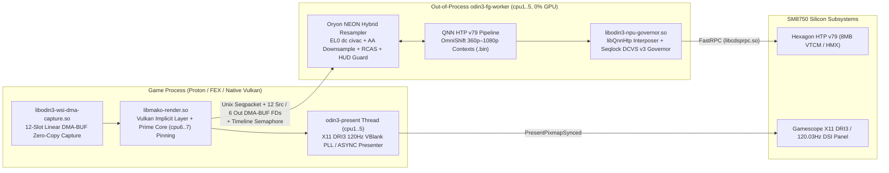

# Odin3-FG-NPU

**English** | [简体中文](README.zh-CN.md)

Local **Hexagon NPU Tier-Matched Hybrid Frame Generation** and **Dynamic NPU Power Governor** Decky plugins and runtime for the **AYN Odin 3** (Qualcomm Snapdragon 8 Elite `SM8750`: Hexagon HTP v79 NPU + Oryon 8-core CPU + Adreno 830 GPU, running ArmadaOS / Gamescope).

By hooking the game's Vulkan swapchain through an implicit layer, sharing zero-copy `DMA-BUF` descriptors with an out-of-process worker (`odin3-fg-worker`), executing frame interpolation across the Hexagon HTP v79 NPU and Oryon Phoenix-M efficiency cores (ARM64 NEON), and presenting directly via X11 DRI3 hardware VBlank phase-locking, the frame generation worker keeps **Adreno GPU rendering load at `0.00%`** without competing for the game's GPU shaders or VRAM bandwidth.

---

## 1. Live Throughput & Honest Visual Limitations

### 1.1 Locked 120 Hz Live Throughput

Verified on an Odin 3 handheld with its 120 Hz DSI panel calibrated to `120.03 Hz` across multiple 2D/3D titles (*Return of the Obra Dinn*, *The Witness*, *The Talos Principle*, *Scarlet Hollow*, *Viewfinder*, *Queen's Domain*, *Life is Strange Remastered*, *Dead as Disco*, and *TUNIC*):

- **2× Frame Generation (`60 FPS` source cap → `120 Hz` output)**: Sustains **`60 native frames + 60 generated frames = 120 FPS`** (`1:1` strict cadence, `0` missed pairs, `0` repeated frames).
- **3× Frame Generation (`40 FPS` source cap → `120 Hz` output)**: Sustains **`40 native frames + 80 generated frames = 120 FPS`** (`1:2` strict cadence, `0` missed pairs, `0` repeated frames).
- **Uncapped Source Frame Rate (High Native FPS)**: Automatically switches to compact low-overhead inference and equidistant asynchronous presentation so generated frames are inserted without dragging down native FPS.


Detailed silicon and live game benchmark records are available in [`docs/benchmarks/`](docs/benchmarks/).

### 1.2 Current Visual Quality & Motion Limitations (Important)

While frame throughput, native frame retention, and NPU power scaling meet their engineering targets, **visual quality and perceived smoothness during fast camera motion still have significant limitations**:

1. **No Engine Motion Vectors or Depth Buffers (Blind RGB Interpolation)**: As a game-agnostic external Vulkan layer, the plugin has no access to per-pixel engine motion vectors, depth buffers, or camera matrices, relying solely on two consecutive `RGB` frames. During **fast 3D camera rotation, wide parallax pans, and complex occlusion/disocclusion boundaries**, visible ghosting, edge tearing, warping ("jelly" artifacts), and reduced perceived smoothness occur.
2. **Mobile NPU Memory & Fixed-Point Quantization Constraints**: To keep activations fully resident inside the `SM8750` Hexagon HTP's 8 MB on-chip VTCM within a tight `6–15 ms` pair budget, the self-trained **OmniShift** network uses a lightweight pure-convolutional architecture quantized to `W8A8` (8-bit weights, 8-bit activations), limiting its capacity on large non-rigid displacements and intricate textures.
3. **Sub-Resolution Upscaling Shimmering on Lower Power Tiers**: Under `Eco (360p)`, `Saver (540p)`, and `Balanced/Auto (720p)`, generated frames are inferred at reduced internal resolution on the NPU and upsampled via CPU NEON + `3×3` RCAS sharpening. Alternating sub-resolution generated frames with crisp `1080p` native frames at 120 Hz introduces noticeable odd/even-frame sharpness flickering on fine details.
4. **Dynamic Translucent UI Artifacts**: Static HUD elements are preserved at full native resolution via frame-difference masking, whereas semi-transparent animated UI, scrolling text, or fine grids moving over dynamic backgrounds can still exhibit local artifacts.

This repository open-sources the complete Decky plugins, Vulkan layer, HTP/NEON hybrid worker, PyTorch training pipeline, and QNN HTP offline compilation scripts for reference, reproduction, and further research.

---

## 2. Installation & Usage Guide

### 2.1 Prerequisites

- **Hardware & OS**: AYN Odin 3 (`SM8750` / `aarch64`) running ArmadaOS (Steam Game Mode + Gamescope + Decky Loader).
- **Qualcomm QAIRT Runtime Libraries (User-Provided)**:
  Neither this repository nor its GitHub Releases distribute proprietary Qualcomm SDK binaries. Before running, extract the Hexagon HTP `v79` runtime libraries from Qualcomm AI Engine Direct (QAIRT / QNN SDK, or copy them from existing QNN runtime directories on the device) into `~/.local/share/odin3-fg/qairt/`:

  ```text
  ~/.local/share/odin3-fg/qairt/
  ├── lib/
  │   ├── libQnnHtp.so
  │   ├── libQnnSystem.so
  │   ├── libQnnHtpV79Stub.so
  │   └── libQnnHtpPrepare.so   # optional
  └── hexagon/
      └── libQnnHtpV79Skel.so
  ```

### 2.2 Installation Steps

Download the four release archives from [Releases](https://github.com/54pkp/Odin3-FG-NPU/releases) and copy them to your Odin 3 (for example, into `/tmp/`):

- `odin3-fg-runtime.tar` (open-source Vulkan layer + `odin3-fg-worker` + FastRPC runtime bundle)
- `omnishift-sm8750-models.tar.gz` (self-trained 5-scale `360p–1080p` OmniShift HTP v79 context binaries)
- `odin3-fg-npu-decky.zip` (frame generation Decky plugin)
- `odin3-npu-power-decky.zip` (NPU power/performance governor Decky plugin)

Run the following commands in an Odin 3 terminal (SSH or Desktop Konsole, default user `armada`):

```bash
# 1. Extract the 5-scale HTP model bundle
mkdir -p ~/.local/share/odin3-fg/models
tar -xzf /tmp/omnishift-sm8750-models.tar.gz -C ~/.local/share/odin3-fg/models

# 2. Install the versioned runtime manager and activate the runtime archive
cp runtime/install_runtime.py ~/.local/share/odin3-fg/install_runtime.py
RT_SHA=$(sha256sum /tmp/odin3-fg-runtime.tar | awk '{print $1}')
python3 -I ~/.local/share/odin3-fg/install_runtime.py stage /tmp/odin3-fg-runtime.tar --sha256 "$RT_SHA"
python3 -I ~/.local/share/odin3-fg/install_runtime.py activate "$RT_SHA"

# 3. Install both Decky plugins and restart Decky Loader
sudo unzip -oq /tmp/odin3-fg-npu-decky.zip -d ~/homebrew/plugins/
sudo unzip -oq /tmp/odin3-npu-power-decky.zip -d ~/homebrew/plugins/
sudo chown -R "$USER:$USER" ~/homebrew/plugins/odin3-fg-npu
sudo chown -R root:root ~/homebrew/plugins/odin3-npu-power
sudo chmod 0755 ~/homebrew/plugins/odin3-fg-npu/py_modules/odin3_fg_launch.py \
                ~/homebrew/plugins/odin3-npu-power/assets/libodin3-npu-governor.so
sudo systemctl restart plugin_loader.service
```

> Alternatively, both `.zip` plugins can be installed from Steam Game Mode via **Decky Settings → Developer → Install Plugin from ZIP File**.

### 2.3 In-Game Configuration & Power Tiers

1. **Open the target game's Steam page (or launch it once)**, press the Quick Access Menu (QAM) button, and open **`Odin3 FG NPU`**:
   - **Multiplier**:
     - `Off (Native Passthrough)`: Automatically removes the launcher token and runs the game untouched.
     - `2× Hybrid FG`: Recommended for games sustaining `>= 60 FPS` native (`60 → 120 FPS`).
     - `3× Hybrid FG`: Recommended for games sustaining `>= 40 FPS` native (`40 → 120 FPS`).
   - **Source FPS Cap**:
     - For locked `120 Hz` VBlank-paced output and higher internal NPU scales, select **`60`** for `2×` or **`40`** for `3×`.
     - Selecting **`Uncapped`** leaves high-FPS games uncapped and automatically runs ultra-low-latency `360p` compact interpolation.
   - **Target Refresh Rate**: Defaults to `120 Hz` (automatically syncs Gamescope's refresh rate on launch and restores the previous setting on exit).
   - **Restart the game** after changing the multiplier or source FPS cap (the plugin automatically injects or removes `~/.local/share/odin3-fg/bin/odin3-fg-launch %command%` in Steam Launch Options).
   - **Disable in-game HDR** and any built-in frame generation inside the game's own graphics settings.

2. Open **`Odin3 NPU Power`** in QAM to switch NPU power/performance presets (**hot-applied immediately to running games without restarting**):

| NPU Preset | HTP Core Corner Cap | Bus Corner Cap | Matched Internal Scale at Locked 120 Hz (`1080p` Swapchain) | Typical Use Case |
| :--- | :--- | :--- | :--- | :--- |
| **`Eco`** | `SVS / SVS+` | `SVS` | `640×360` (`360p` hybrid upscale) | Lowest system power & heat; maximum battery life |
| **`Saver`** | `NOM+` | `NOM` | `960×540` (`540p` hybrid upscale) | Substantial NPU & LPDDR5X bus power reduction |
| **`Balanced`** | `TURBO` | `NOM+` | `1280×720` (`720p` hybrid upscale) | Balanced sharpness, latency, and thermals |
| **`Auto` (Recommended)** | Dynamic `NOM ~ MAX` | Dynamic `SVS+ ~ TURBO+` | `1280×720` (`720p` hybrid upscale) | Scales voltage dynamically by live duty cycle with inter-frame sleep |
| **`High`** | `MAX` (with sleep) | `NOM+` | `1600×900` (`900p` hybrid upscale) | High-resolution inference while retaining inter-frame HMX power-down |
| **`Max`** | `MAX` | `NOM+` | `1600×900` (`900p` hybrid upscale) | Maximum NPU headroom (runs native zero-scale on `720p/900p` swapchains) |
| **`Passthrough`** | Client default vote | Client default vote | Highest available scale | Bypasses governor voltage overrides |

### 2.4 Rollback & Uninstallation

```bash
# Roll back to the previously active runtime release
python3 -I ~/.local/share/odin3-fg/install_runtime.py rollback

# Check active runtime digest
python3 -I ~/.local/share/odin3-fg/install_runtime.py status
```

To completely uninstall:
1. Set any enabled games back to `Off` inside `Odin3 FG NPU` (even if `~/.local/share/odin3-fg/bin/odin3-fg-launch` remains in a game's Launch Options, it safely execs the original game command once the runtime directory is removed).
2. Restore the original `libQnnHtp.so` and remove the plugins and state directories:
   ```bash
   if [[ -f ~/.local/share/odin3-fg/qairt/lib/libQnnHtp.real.so ]]; then
       mv -f ~/.local/share/odin3-fg/qairt/lib/libQnnHtp.real.so ~/.local/share/odin3-fg/qairt/lib/libQnnHtp.so
   fi
   sudo rm -f /etc/systemd/system/vela-npu.service.d/60-odin3-npu-governor.conf \
              /etc/tmpfiles.d/odin3-npu-governor.conf \
              /etc/tmpfiles.d/odin3-fg-panel-120hz.conf
   sudo systemctl daemon-reload
   sudo rm -rf ~/homebrew/plugins/odin3-fg-npu ~/homebrew/plugins/odin3-npu-power /var/lib/odin3-npu-governor /run/odin3-npu-governor
   rm -rf ~/.local/share/odin3-fg ~/.config/odin3-fg ~/.cache/odin3-fg \
          ~/.config/odin3-npu-governor ~/.cache/odin3-npu-governor \
          ~/.local/share/vulkan/implicit_layer.d/VkLayer_MAKO_render.json
   sudo systemctl restart plugin_loader.service
   ```

---

## 3. Upstream Technologies & Open-Source Credits

This project builds directly upon the following upstream projects and platform technologies (see [`sources.json`](sources.json) and [`licenses/`](licenses/)):

1. **[MAKO](https://github.com/eugeniosegala/MAKO)** (`GPL-3.0-or-later`, descended from **[lsfg-vk](https://github.com/PancakeTAS/lsfg-vk)**):
   Provides the Vulkan implicit layer foundation (`VK_LAYER_MAKO_render` / `libmako-render.so`), swapchain lifecycle hooks, and out-of-process Unix `SOCK_SEQPACKET` + Vulkan Timeline Semaphore IPC framework. Extended in this project with 12-slot zero-copy WSI `DMA-BUF` capture, X11 DRI3 hardware VBlank PLL presentation, thread-safe multi-`VkInstance`/`VkDevice` dispatch routing, and Hexagon HTP shared-buffer scheduling.
2. **[Qualcomm FastRPC](https://github.com/qualcomm/fastrpc)** (`BSD-3-Clause`) & **Qualcomm QAIRT / QNN HTP SDK**:
   Uses open-source `cdsprpcd` and `libcdsprpc.so` for Linux userspace-to-cDSP communication and zero-copy `DMA-BUF` mapping on `SM8750`, QNN HTP `v79` APIs to execute offline-compiled context binaries (`.bin`), and `QnnHtpPerfInfrastructure` (`DCVS_V3`) for core/bus voltage voting, RPC latency control, and HMX power-gating timeouts.
3. **[Decky Loader](https://github.com/SteamDeckHomebrew/decky-loader)** (`BSD-3-Clause`):
   Provides the Steam Game Mode Quick Access Menu plugin host; token-preserving Steam `localconfig.vdf` Launch Options synchronization draws inspiration from `decky-lsfg-vk`.
4. **Gamescope / Mesa Turnip Vulkan WSI / X11 DRI3 & Present Extensions**:
   Leverages Mesa X11 WSI DRI3 `DMA-BUF` export during swapchain creation and Gamescope `:0` `PresentPixmapSynced` explicit timeline synchronization for hardware VBlank-paced presentation.
5. **[Khronos Vulkan-Headers](https://github.com/KhronosGroup/Vulkan-Headers)** (`Apache-2.0`) & **[LibYAML](https://github.com/yaml/libyaml)** (`MIT`):
   Used for cross-compiling the Vulkan layer and building FastRPC.
6. **PyTorch & ONNX**:
   Used to train the custom pure-convolutional **OmniShift** interpolation network, run Stage-2 `W8A8` Quantization-Aware Training (QAT), and export static NHWC graphs.

---

## 4. Technical Architecture



### 4.1 Zero-Copy WSI `DMA-BUF` Capture Bridge (`engine/wsi-dma-capture/`)

Conventional Vulkan frame generation layers inject a full-screen `vkCmdCopyImage` on the game's graphics queue every frame to export swapchain images into shared memory, adding GPU memory traffic and pipeline stalls at `1080p`.

`libodin3-wsi-dma-capture.so` intercepts `xcb_dri3_get_supported_modifiers_reply` and `xcb_dri3_pixmap_from_buffers_checked` during swapchain creation, negotiates `DRM_FORMAT_MOD_LINEAR` when supported, and duplicates the 12 underlying swapchain `DMA-BUF` file descriptors. Once the game finishes rendering a frame, an empty queue submit relays `VkTimelineSemaphore` signaling with zero post-draw image copies, sharing the exact same physical memory across:
- Zero-copy X11 DRI3 native frame scanout; and
- Direct NPU/NEON read access inside `odin3-fg-worker`.

When a swapchain does not support linear modifier export, the layer falls back to pre-recorded per-slot `VK_PIPELINE_STAGE_TRANSFER_BIT` async copy command buffers without top-of-pipe full-GPU barriers.

### 4.2 X11 DRI3 Hardware VBlank PLL Presenter (`engine/mako-render/`)

`independent_real_present.cpp` and `direct_x11_present.hpp` decouple presentation from the game's `vkQueuePresentKHR` thread, driving 12 native slots and 6 generated slots directly via XCB `PresentPixmapSynced` on a dedicated `odin3-present` thread:

- **Locked 120 Hz VBlank PLL Mode**: Locks onto hardware page-flip timestamps (`ust`) and counters (`msc`) from DRI3 `PresentCompleteNotify` events, anchoring submission deadlines at **22% of each `8.33 ms` VBlank period** and targeting explicit `target_msc` slots in strict `G -> O` (`2×`) or `G1 -> G2 -> O` (`3×`) order.
- **Dynamic 1-Phase / 2-Phase Adaptation in `3×` Contexts**: Each `3×` HTP pipeline loads both dual-phase decoders (`phase13.bin` + `phase23.bin`) and a midpoint decoder (`phase12.bin`). At 40 FPS capped input it executes full dual-phase `1:2` synthesis (`120 FPS`); when uncapped native FPS rises above ~55 FPS, it seamlessly drops to single-phase `t=0.5` midpoint synthesis within the same context to prevent deadline overruns.
- **Uncapped Equidistant `ASYNC` Mode**: When uncapped native FPS exceeds half the display refresh rate, presentation switches to `XCB_PRESENT_OPTION_ASYNC` so VSync queue backpressure never throttles native game performance.
- **DSI Panel 120 Hz Calibration**: The Odin 3 factory DSI `frame_len_120=76` runs at `~118.96 Hz`, causing periodic beat-frequency stutter against a 60/40 FPS cap; `Odin3 FG NPU` automatically calibrates it to `56` (`120.02–120.14 Hz` across operating temperatures).

### 4.3 OmniShift Pure-Convolutional Multi-Scale VFI Network (`training/omnishift_vfi.py`)

An end-to-end pure-convolutional optical-flow interpolation model purpose-built and trained from scratch for `SM8750` Hexagon HTP v79 (zero custom HVX/DSP ops, zero `GridSample` fallbacks):

- **64-Channel HMX Tile Alignment & Full VTCM Residency**: Internal channel counts (`48/64/96/192/384`) align to Hexagon HMX tile multiples so intermediate activations remain inside the 8 MB VTCM without spilling to LPDDR5X.
- **Zero-Offset Symmetric `[0, 1]` `YBGR24` Subpixel Codec**: Unpacks `4×4` blocks into 16 full-resolution `1×1` luma channels (`Y_p`) plus 8 `2×4` half-block average chroma/luma channels (`B_h, G_h, R_h, Y_h`), reconstructing via bias-free `C_p = C_h + Y_p - Y_h`. Pure black `[0,0,0]` maps to exact zero across all channels, and monochrome / 1-bit dithered scenes (`B == G == R`) apply bit-identical shift weights across all four half-block groups for zero color cast.
- **Exact-Complement Partition-of-Unity (`w0 = 1 - sum(wnz)`) & Border-Safe Padding**: Both ternary coarse shift layers (`ExactComplementTernaryCoarse24`) and 8-tap `[-4, +4] px` fine tent layers (`ExactComplementTent8Tap4px24`) compute the stationary weight `w0` directly as the complement of quantized non-zero tap weights `wnz`, guaranteeing `q(w0) + sum(q(wnz)) == 255/255 == 1.0` across flow contours (eliminating pure-white `[255,255,255]` quantization shattering), while explicit edge replication (`replicate_pad_2d`) eliminates bottom-border color bleed.
- **Split Multi-Graph Bundle**: Each resolution scale ships 5 precompiled HTP context binaries:
  - `vfi-joined.bin`: Fused single-graph `2×` (`t=0.5`) native-scale network;
  - `vfi-motion3x.bin`: Shared symmetric motion & occlusion latent encoder (executed once per frame pair);
  - `phase12.bin` / `phase13.bin` / `phase23.bin`: Lightweight phase synthesis decoders for `t=1/2`, `t=1/3`, and `t=2/3`.

### 4.4 Oryon Cluster Isolation & ARM64 NEON Hybrid Resampler (`worker/odin3_tier_engine.hpp`)

`SM8750` pairs six `3.53 GHz` Phoenix-M cores (`cpu0..5`) with two `4.09 GHz` Phoenix-L Prime cores (`cpu6..7`):

- **Strict Dual-Cluster Isolation**: The layer monitors per-thread CPU ticks in the game process and pins the 1–2 heaviest game rendering threads onto Prime `cpu6..7`, while confining `odin3-present` and `odin3-fg-worker` (including NEON worker threads) to `cpu1..5` (avoiding IRQ-heavy `cpu0`) so frame generation never preempts Prime cores.
- **Userspace EL0 `dc civac` Sampled-Row Cache Maintenance**: Executes ARM64 `dc civac` cache invalidation directly on `mmap`ped `DMA-BUF` rows actually read by the downsampler, avoiding full-frame kernel `DMA_BUF_IOCTL_SYNC` stalls on GPU `dma_resv` fences.
- **NEON Anti-Aliased Downsampling, Ring-Free RCAS & Static HUD Protection**:
  - Downsampling uses `2×2` Box (`1080p→540p`), exact `3:2` box filtering with non-temporal `stnp` stores (`1080p→720p`), and `3×3` Tent anti-aliasing (`1080p→360p`) to suppress camera-pan aliasing;
  - Single-pass upsampling fuses bilinear interpolation, tier-adaptive ring-free `3×3` RCAS contrast sharpening, and full-resolution static HUD/monochrome protection (preserving native `1080p` pixels where `|A - B|` is static);
  - In scaled `3×` mode, a background worker thread overlaps `P().render(1)` (second-phase NPU execution) concurrently with `upsampleOutput(0)` (first-phase CPU NEON upsampling).

### 4.5 `libQnnHtp.so` Seqlock Power Governor & HMX Thermal Guard (`npu-governor/npu_governor_shim.cpp`)

Because the `SM8750` Hexagon NPU exposes no Linux kernel `devfreq` node, clocks, voltage corners, and sleep states are voted from user space via QNN `DCVS_V3`:

- `libodin3-npu-governor.so` loads in front of Qualcomm's library as `libQnnHtp.so`, wrapping `QnnInterface_getProviders`, `deviceGetInfrastructure`, and `graphExecute`;
- Enforces `RPC_POLLING_TIME = 0` so host ARM64 threads enter `WFI` sleep instead of busy-spinning during cDSP execution;
- Polls a shared 128-byte `mmap` seqlock configuration (`/run/odin3-npu-governor/config.bin`) before each inference for zero-restart voltage corner hot-switching and writes live FPS, latency, duty cycle, and corner telemetry to `/run/odin3-npu-governor/telemetry/`;
- `odin3-fg-worker` monitors `nsphmx` thermal zones and proactively steps down the maximum internal resolution cap across `85°C / 88°C / 90.5°C` thresholds to prevent thermal throttling.

---

## 5. Repository Structure & Building from Source

```text
Odin3-FG-NPU/
├── engine/                 # Vulkan implicit layer (libmako-render.so) & zero-copy WSI capture (libodin3-wsi-dma-capture.so)
│   ├── mako-common/        # Vulkan wrappers, configuration, and htp_deadline runtime parameters
│   ├── mako-backend/       # Out-of-process worker lifecycle & shared DMA-BUF scheduling protocol
│   ├── mako-render/        # Swapchain hooks, X11 DRI3 VBlank PLL presenter & Oryon thread Affinity
│   └── wsi-dma-capture/    # xcb-dri3 linear modifier negotiation & DMA-BUF export interposer
├── worker/                 # Out-of-process worker (odin3-fg-worker): QNN HTP v79 pipeline + Oryon NEON resampler
├── npu-governor/           # libQnnHtp.so dynamic DCVS v3 voltage/sleep interposer (libodin3-npu-governor.so)
├── runtime/                # Versioned runtime installer (install_runtime.py), wrapper (odin3-fg.sh) & profile CLI
├── decky-fg/               # Decky plugin: Odin3 FG NPU (per-game FG profiles & 120Hz panel calibration)
├── decky-npu-power/        # Decky plugin: Odin3 NPU Power (live NPU power presets & thermal/power telemetry)
├── training/               # OmniShift PyTorch architecture, FP32+W8A8 QAT trainer & 5-scale QNN HTP compiler
├── scripts/                # Cross-compile & packaging script (build_all.py) and benchmark verifier (check_acceptance.py)
├── docs/                   # Live benchmark comparison chart & sanitized benchmark JSON reports
├── licenses/               # Upstream open-source license texts (MAKO / FastRPC / LibYAML)
└── sources.json            # Pinned upstream open-source repositories and commit hashes
```

### 5.1 Cross-Compiling the Runtime & Decky Plugins

Build prerequisites:
- Python `>= 3.11`
- [Zig](https://ziglang.org/) `>= 0.14` (used as the `aarch64-linux-gnu` C/C++ cross-compiler)
- Node.js `>= 18` (for building the TypeScript/React Decky plugin frontends)
- Khronos `Vulkan-Headers`, `aarch64` Linux/X11/XCB/DRM sysroot headers, and an `aarch64` `libvulkan.so.1` link stub
- Qualcomm QAIRT SDK `include/QNN` headers
- Prebuilt open-source `aarch64` `qualcomm/fastrpc` binaries (`cdsprpcd`, `libcdsprpc.so`, `libcdsp_default_listener.so.1`)

Set the toolchain environment variables and run `scripts/build_all.py` (outputs to `dist-release/`):

```bash
export ODIN3_ZIG=/path/to/zig
export ODIN3_VULKAN_INCLUDE=/path/to/Vulkan-Headers/include
export ODIN3_LINUX_SYSROOT=/path/to/aarch64-sysroot/usr/include
export ODIN3_QAIRT_INCLUDE=/path/to/qairt/include/QNN
export ODIN3_VULKAN_STUB_SO=/path/to/aarch64-sysroot/usr/lib/libvulkan.so.1
export ODIN3_FASTRPC_DIR=/path/to/fastrpc-aarch64

python scripts/build_all.py --models-dir /path/to/omnishift-sm8750
```

### 5.2 Training OmniShift & Compiling SM8750 HTP Context Binaries

```bash
# 1. Train Stage-1 FP32 + Stage-2 W8A8 QAT model on [N, 3, H, W, 3] uint8 BGR frame triplets (.npy)
python training/train_omnishift.py \
    --data-npy /path/to/triplets.npy \
    --out-dir runs/omnishift_sm8750 \
    --steps 20000 --qat-start 15000

# 2. Export 5-scale (360p/540p/720p/900p/1080p) ONNX graphs and compile HTP v79 context binaries (.bin)
python training/export_and_compile_htp.py \
    --ckpt runs/omnishift_sm8750/omnishift_vfi_sm8750.pt \
    --qairt-sdk /path/to/qairt/2.x \
    --out-dir models/omnishift-sm8750
```

---

## 6. License

This repository's source code is licensed under the **[GNU General Public License v3.0 or later (`GPL-3.0-or-later`)](LICENSE)**. Upstream open-source component licenses are located in [`licenses/`](licenses/). Qualcomm QAIRT / QNN SDK is proprietary software owned by Qualcomm Technologies, Inc. and is not distributed in this repository; obtain and use it in accordance with Qualcomm's license terms.
